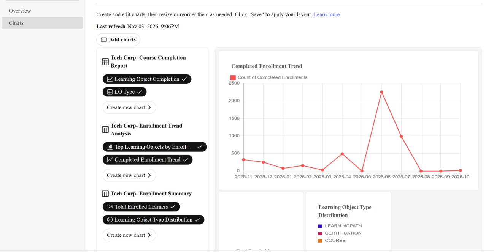

# Report Builderのビジュアライゼーション

Adobe Learning Manager Report Builderのビジュアライゼーションは、保存されたレポートをチャートとダッシュボードに変換します。 スプレッドシートツールでデータを変更することなく、グループの比較、トレンドの把握、結果の共有を行うことができます。

>[!IMPORTANT]
>
>Report Builderのビジュアライゼーション（チャートとダッシュボード）は、Adobe Learning Manager Ultimateのお客様のみが使用できます。 Primeエディションでは使用できません。

## Report Builderでのビジュアライゼーションについて {#about-visualizations}

ビジュアライゼーションとは、Report Builderで保存したレポートから作成されたチャートまたはチャートのダッシュボードです。 プロットするレポート列を選択すると、Report Builderによってレポートデータからチャートが作成されます。 列を直接印刷したり、レポートから集計データを印刷することができます。

* **レポートのグラフを作成する：**&#x200B;レポートを開き、**視覚化**&#x200B;を選択して、グラフを作成します。 [レポートからグラフを作成する](#create-chart-from-report)を参照してください。
* **ダッシュボードのグラフをグループ化する：**&#x200B;データソースとしてレポートを選択し、そのレポートからグラフを追加します。 [ダッシュボードの作成](#build-dashboard)を参照してください。
* **共有と表示：**&#x200B;管理者とダッシュボードを共有します。管理者は、ダッシュボードを読み取り専用モードで表示し、フィルター処理を行います。

チャートは、次の2つのモードで機能します。

* **構成モード：**&#x200B;グラフを作成または編集します。
* **表示モード：**&#x200B;グラフの組み立て方法を変更せずに、グラフの表示内容をフィルター処理します。

## グラフの種類と使用する状況 {#chart-types}

答えたい質問に応じてグラフの種類を選択します。

| チャートタイプ | 用途： | 例 |
|---|---|---|
| 折れ線グラフ | 時間の経過に伴う値の変化を示します。 | 作成月別の登録 |
| バーまたは列 | カテゴリ間で値を比較します。 グループ化されたレイアウト、積み上げレイアウト、100%積み上げレイアウトを使用できます。 | 登録ステータス別の学習者 |
| 円 | 各カテゴリの全体に対する割合を表示します。 1%未満のセグメントは、**その他**&#x200B;セグメントにグループ化されます。 | カタログ別の登録 |
| Big number | 主要なメトリックを1つハイライト表示します。 | 今四半期の完了合計 |
| 表 | 正確な値を表示します。 列のサブセットを選択し、1つの日付列を列ではなく行として表示できます（列対行表示）。 | ユーザーあたりの学習時間（月） |

>[!NOTE]
>
>月別の登録などのトレンド・レポートから作成された折れ線グラフには、データの現在のスナップショットが日付別にグループ化されて表示されます。 彼らはデータが各過去の日付でどのように見えたかを示していません。 詳しくは、 Report Builderの概念と用語を参照してください。

## 視覚化の用語 {#visualization-terms}

| 用語 | 意味 |
|---|---|
| レポート | 列、フィルタ、およびグループ化の保存されたReport Builder構成。 チャートはレポートから作成されます。 |
| チャートレベルのフィルター | チャートの作成時または編集時に設定するフィルタ。 グラフでプロットされるデータが制限されます。 |
| ページレベルフィルター | ビューアのフィルタは、ページまたはダッシュボードのすべてのチャートに適用されます。 レポート独自のフィルターを狭くすることはできますが、広げることはできません。 |
| Report Builderダッシュボード | Report Builderで作成するチャートのページ。 |

## レポートからグラフを作成する {#create-chart-from-report}

保存されたレポートからグラフを作成し、登録、完了、または時間の経過に関するデータを一目で確認できます。 グラフは1回設定し、開くたびにレポートデータから取得されます。

### チャートの作成前 {#before-you-create-chart}

次の項目を確認します。

* **レポートを保存します。** レポートを保存すると、グラフを追加するオプションがReport Builderページに表示されます。
* **自分のレポートを使用する。** 共有レポートを複製して独自のコピーを作成し、それを使用してチャートを作成します。
* **サイズを確認してください。** 1,000万行以上のレポートは印刷できません。 10,000を超えるデータポイントを含む要約レポートは印刷されません。 チャートとダッシュボードの制限を参照してください。
* **視覚化するデータを最適化します。** 適切なレポートレベルまたはチャートレベルのフィルターを適用して、プロットされるデータの量を制限します。 グラフの読み込みに必要な時間は、レポートデータの量、選択した日付範囲、レポートで使用するデータセットとテーブルの組み合わせなどの要因によって異なります。 大量のデータまたは複雑なデータセットの組み合わせを処理するレポートは、読み込みに時間がかかる場合やタイムアウトする場合があります。 その場合は、フィルターまたは日付範囲を絞り込んでもう一度やり直してください。
* **列について知る。** チャートのX軸（次元）とY軸（メジャー）は、レポートの列から取得されます。 レポート自体を要約するには、**グループ化**&#x200B;と集計を使用します。 詳細については、「 Apply group by and aggregations 」を参照してください。

### チャートの設定 {#configure-chart}

1. Adobe Learning Managerに管理者としてログインします。
1. **レポート**&#x200B;を選択し、**Report Builder**&#x200B;を選択します。
1. **レポート**&#x200B;タブを選択し、保存したレポートを開きます。 この例では、学習プラットフォームに各日付にログインしたユーザーの数を示すユーザーログイントレンドレポートを選択します。
1. 左側のナビゲーションで、**視覚化**&#x200B;を選択します。 パネルが開き、**設定**&#x200B;と&#x200B;**スタイル**&#x200B;のタブが表示されます。

   ![[セットアップ]タブと[スタイル]タブのある[視覚エフェクト]パネル](assets/V2_Adobe-Learning-Manager--Report-Builder-visualization-p5-1.png "[視覚エフェクト]パネル")

   >[!NOTE]
   >
   >グラフが存在したら、**編集**&#x200B;を選択し、**+**&#x200B;を選択して別のグラフを追加します。

1. **グラフの種類**&#x200B;で、**折れ線グラフ**&#x200B;などの種類を選択します。 このフィールドは必須です。
1. **Dimension- X 軸**&#x200B;の横にある追加アイコンをクリックし、レポート列をクリックします。 日付の列に対して、日付や月などの&#x200B;**日付の粒度**&#x200B;も選択します。

   {width="650"}

1. **[追加]**&#x200B;を選択して、日付ディメンションを追加します。
1. **メジャー – Y 軸**&#x200B;の横にある追加アイコンをクリックし、レポート列と集計方法（**カウント**&#x200B;など）をクリックします。

   {width="650"}

1. **[追加]**&#x200B;を選択してメジャーを追加します。
1. （オプション） **フィルターの追加**&#x200B;を選択して、プロットするデータを過去30日間などの範囲に制限します。 「**追加**」を選択します。

   {width="650"}

1. （オプション） **並べ替え**&#x200B;列を追加し、**昇順**&#x200B;または&#x200B;**降順**&#x200B;を選択します。 「**追加**」を選択します。

   ![[昇順]と[降順]のオプションを使った並べ替えの設定](assets/V2_Adobe-Learning-Manager--Report-Builder-visualization-p7-2.png "並べ替えの設定"){width="650"}

1. （オプション）折れ線グラフの場合は、欠落しているデータに対して&#x200B;**ギャップ処理**&#x200B;を設定します。 [不足しているデータのギャップ処理](#gap-handling)を参照してください。
1. **最大データ要素**&#x200B;に、グラフにプロットするデータ要素の数を入力します。 デフォルトは100ポイントで、上限は10,000です。
1. **残りのポイントを「その他」としてグループ化**&#x200B;をオンにします。 Report Builderには、**最大データポイント**&#x200B;値までの個々のデータポイントが表示され、その上限を超えるすべてのデータポイントが&#x200B;**その他**&#x200B;と呼ばれる1つのカテゴリにまとめられます。

   たとえば、**最大データポイント**&#x200B;が150で、クエリが200ポイントを返した場合：

   * Report Builderは150ポイントを個別に表示します。
   * Report Builderは、残りの50ポイントを&#x200B;**その他**&#x200B;に組み合わせます。
   * グラフには151のプロットポイントが表示されます： 150と&#x200B;**その他**。

1. 「**次へ**」を選択します。 これで、グラフをカスタマイズできます。

   ![[次へ]ボタンがあるタブのセットアップ](assets/V2_Adobe-Learning-Manager--Report-Builder-visualization-p9-1.png "[次へ]を選択"){width="650"}

#### 欠落データのギャップ処理 {#gap-handling}

ギャップ処理では、系列の1つ以上の観測値に数値がない場合にグラフが行う処理（NULL、NA、NaN、空のセルなど）を定義します。

次のようなデータがあるとします。

| X | 値 |
|---|---|
| Jan | 10 |
| Feb | 15 |
| Mar | 該当しません |
| Apr | 該当しません |
| 5 月 | 25 |

次の表に、3つの動作を示します。

| 欠損値の処理 | 概念的結果 | プロット方法 |
|---|---|---|
| ゼロまで線を引く | `10 -> 15 -> 0 -> 0 -> 25` | 欠落している値を0として扱います。 |
| スキップ | `10 -> 15   25` | 欠落した点を印刷せず、線を切断します。 |
| 接続 | `10 -> 15 ----> 25` | 不明な点は印刷されませんが、両側で有効な観測情報を接続します。 |

>[!NOTE]
>
>Connectは補間ではありません。 3月と4月が指定されていない場合、2月を5月に直接接続すると、2つの既知の値の間に視覚的な線のみが描画されます。 実際の3月と4月の値は作成されません。

### チャートのカスタマイズ {#customize-chart}

グラフをカスタマイズして、明確で読みやすくすることができます。 [**スタイル**]タブでは、タイトルを追加したり、軸のタイトルと凡例の表示と非表示を切り替えたり、凡例の配置と整列を行ったり、各系列の色を設定したりできます。 スタイルの変更は、チャートの外観にのみ影響します。 印刷されるデータは変更されません。

1. グラフの上にタイトルを表示するには、**グラフのタイトルを表示**&#x200B;を選択します。 非表示にするには、このオプションをオフにします。
1. **グラフのタイトル**&#x200B;に、グラフのタイトルを入力します。
1. **[X軸のタイトルを表示]**&#x200B;と&#x200B;**[Y軸のタイトルを表示]**&#x200B;を選択して、軸にラベルを付けます。
1. 各行を識別するキーを表示するには、[**凡例を表示**]を選択します。
1. **凡例の位置**&#x200B;で、左、中央、または右のアイコンを選択して凡例を配置します。
1. **線の色**&#x200B;で、系列の横にあるカラースウォッチ（**ユーザー数**&#x200B;など）を選択します。
1. カラーピッカーで、パレットからカラーを選択するか、カスタムタブを使用して独自のカラーを定義します。
1. 再配色する線ごとに前の2つの手順を繰り返します。
1. **作成**&#x200B;を選択して、グラフを追加します。 既存のグラフを編集している場合は、[**保存**]を選択します。

   ![グラフタイトル、凡例、線の色のオプションが表示された[スタイル]タブ](assets/V2_Adobe-Learning-Manager--Report-Builder-visualization-p10-1.png "[スタイル]タブ"){width="650"}

タイトル、凡例、線の色でグラフが表示されます。

>[!TIP]
>
>* 背景とのコントラストが明確なカラーを選択します。 タイトルと凡例は同じ色で表示し、線の区別ができないようにします。
>* **凡例の位置**、**凡例のアラインメント**、および&#x200B;**線の色**&#x200B;の各オプションは、**凡例の表示**&#x200B;がオンになっている場合にのみ適用されます。
>* グラフの各線には独自のスウォッチがあります。スウォッチは、[**設定**]タブで追加した単位ごとに1つです。

1ページにグラフを配置する方法については、[ダッシュボードの作成](#build-dashboard)を参照してください。

## 円グラフを作成する {#create-pie-chart}

円グラフを使用して、必須トレーニングを完了した従業員の割合やコース形式の組み合わせなど、全体がどのように部分に分割されるかを示します。 各スライスは、合計に対する1つのカテゴリのシェアを示します。

### 円グラフについて {#about-pie-charts}

円グラフは、カテゴリごとに1つのスライスを描画します。 スライス・サイズは、そのカテゴリの合計メジャーのシェアを示します。 凡例は各スライスを識別し、各スライスはその値を表示します。

ユーザーが正確な値より多くの比率を必要とする場合に、円グラフを使用して、いくつかのカテゴリにわたって全体の一部を表示します。 多くのカテゴリを比較するには、棒グラフを使用します。 時間の経過に伴う変化を示すには、折れ線グラフを使用します。

### 円グラフの作成手順 {#pie-chart-steps}

始める前に、所有しているレポートを保存します。 カテゴリ用に1列、測定用に1列を含めます。

1. **レポート**&#x200B;を選択し、**Report Builder**&#x200B;を選択します。 [**レポート**]タブで、保存されたレポートを開きます。
1. 左側のナビゲーションで、**視覚化**&#x200B;を選択します。
1. **グラフの種類**&#x200B;で、**円グラフ**&#x200B;を選択します。
1. 「**Dimension – セグメント**」の横にある「追加」アイコンをクリックし、スライスを定義する列を選択します。 例えば、**トランスクリプト（学習目標） – ステータス**&#x200B;を選択します。
1. **メジャー – 値**&#x200B;の横にある追加アイコンを選択し、列を選択してスライスのサイズを集計します（**カウント**&#x200B;など）。
1. （オプション）[**最大データポイント**]に、描画するスライスの最大数を入力します。 デフォルト値は100です。
1. （オプション）下位カテゴリを組み合わせるには、**残りのポイントを「その他」としてグループ化**&#x200B;をオンにします。
1. 「**次へ**」を選択して、円グラフをカスタマイズします。

### 円グラフをカスタマイズする {#customize-pie-chart}

1. タイトルを表示するには、**グラフのタイトルを表示**&#x200B;をオンにします。 タイトルを非表示にするには、このオプションをオフにします。
1. **グラフのタイトル**&#x200B;に、`Mandatory Compliance Completion`などのタイトルを入力します。
1. **グラフスタイル**&#x200B;で、円（塗りつぶし）の場合は&#x200B;**円**、円（リング）の場合は&#x200B;**ドーナツ**&#x200B;を選択します。
1. **[凡例の表示]**&#x200B;を選択して、凡例をグラフに表示します。
1. **凡例の位置**&#x200B;で、凡例が表示される場所を選択します。
1. **凡例アラインメント**&#x200B;で、左、中央、または右を選択します。
1. 新しいグラフの&#x200B;**作成**&#x200B;を選択します。 既存のグラフを編集する場合は、**[保存]**&#x200B;を選択し、**[視覚化]**&#x200B;ページの&#x200B;**[保存]**&#x200B;を選択します。

   {width="650"}

Report Builderによって円グラフまたはドーナツグラフが作成されます。

## 棒グラフを作成する {#create-bar-chart}

棒グラフを使用して、チーム別のトレーニングステータスや顧客別の学習時間など、カテゴリ間でメジャーを比較します。 バーは比較やランク付けが簡単で、グループ化やスタック化を行って2つ目の内訳を追加することができます。

### 棒グラフについて {#about-bar-charts}

棒グラフは、X軸の各項目に1本の棒を描きます。 バーの長さは、学習者の数など、Y軸のメジャーを示します。 棒は、縦（列）または横に描画できます。

棒グラフを使用して、次の操作を行います。

* チーム、パートナー、顧客などのカテゴリ間で値を比較します。
* カテゴリを高い順にランク付けします。
* 各パートナー内の状態など、各バー内の2番目の内訳を表示します。

### 棒グラフを作成する前に {#before-you-create-bar-chart}

* レポートを保存し、自分が所有するレポートを使用します。
* カテゴリの列と計測する列を含めます。
* チャートとダッシュボードの制約条件の範囲内でレポートを維持します。

### 棒グラフの作成手順 {#bar-chart-steps}

1. **レポート**&#x200B;を選択し、**Report Builder**&#x200B;を選択します。 [**レポート**]タブで、保存されたレポートを開きます。
1. 左側のナビゲーションで、**視覚化**&#x200B;を選択します。
1. **グラフの種類**&#x200B;で、**横棒グラフ**&#x200B;を選択します。
1. [**Dimension - X軸**]の横にある[追加]アイコンをクリックし、カテゴリを定義する列をクリックします。 「**完了**」を選択します。

   {width="650"}

1. **メジャー – Y 軸**&#x200B;の横にある追加アイコンを選択し、列と列の集計方法（**カウント**&#x200B;など）を選択します。 「**完了**」を選択します。

   {width="650"}

1. （オプション） **フィルター**&#x200B;を追加してデータを制限し、**並べ替え**&#x200B;を設定して棒を列で並べ替えます。
1. **最大データ要素**&#x200B;に、プロットするデータ要素の最大数を入力します。 150と入力すると、Report Builderは最大150個の個別のデータポイントを表示し、その制限を超えるすべてのデータポイントを&#x200B;**その他**&#x200B;と呼ばれる1つのカテゴリにまとめます。
1. 「**次へ**」を選択して、横向き棒グラフをカスタマイズします。

### 横向き棒グラフのカスタマイズ {#customize-bar-chart}

[**スタイル**]タブを使用して、タイトル、方向、グループ化、凡例、および色を設定します。 スタイルの設定は、グラフをプロットするデータではなく、グラフの見え方を変更します。

1. 「**スタイル**」タブを選択します。
1. タイトルを表示するには、**グラフのタイトルを表示**&#x200B;をオンにします。 **グラフのタイトル**&#x200B;に、`Most Popular Courses`などのタイトルを入力します。
1. 軸にラベルを付けるには、**X軸のタイトルを表示**&#x200B;をオンにし、**Y軸のタイトルを表示**&#x200B;をオンにします。 オプションをオフにすると、そのタイトルが非表示になります。
1. **グラフスタイル**&#x200B;で、列の場合は&#x200B;**縦**&#x200B;を選択し、横に延びる横棒の場合は&#x200B;**横**&#x200B;を選択します。 水平バーを使用すると、長いカテゴリ名を表示するスペースが大きくなります。
1. **横向き棒のグループ化**&#x200B;で、3つのアイコンのいずれかを選択し、複数の系列が1つの項目をどのように共有するかを設定します：グループ化、積み上げ、または100%積み上げ。
1. 各シリーズを識別するには、**[凡例の表示]**&#x200B;をオンにします。
1. **凡例の位置**&#x200B;で、凡例が表示される場所を選択します。 **凡例アラインメント**&#x200B;で、左、中央、または右を選択します。
1. **[バーの色]**&#x200B;で、系列の横にある見本を選択し、色を選択します。
1. 新しいグラフの&#x200B;**作成**&#x200B;を選択します。 既存のグラフを編集する場合は、[**保存**]を選択します。

>[!NOTE]
>
>**バーのグループ化**&#x200B;は、2つのメジャーなど、1つのバーに複数の系列がある場合にのみ重要です。 凡例を表示したままにしてデータラベルを表示すると、系列を区別する唯一の方法が色だけではありません。

## 大きな数を作成する {#create-big-number}

大きい数値を使用して、1つの主要メトリックを、学習者の合計数、登録遅延または有効なユーザーなど、大きく読みやすい数値として表示します。 大きな数値はダッシュボードの上部でうまく機能し、閲覧者は最初に主要な数値を確認します。

### ビッグナンバーについて {#about-big-numbers}

大きい数字は、値とラベルの2つの部分で構成されるタイルです。 値は、カウントや合計など、レポートから計算される単一の数値です。 ラベルは数字の意味を視聴者に伝える。 大きい数値には、軸、凡例、または項目がありません。

次の場合は、大きい数値を使用します。

* 誰かが定期的にチェックする見出し図を表示します。
* ダッシュボードの下にある詳細チャートの前に、コンテキストを表示します。

### 大きな数を作成する手順 {#big-number-steps}

始める前に、自分が所有するレポートを保存します。 必要な数値と、その数値を生成する列および集計を決定します。

例えば、トレーニング管理者は毎月、組織が完了したトレーニングの量をレポートします。 リーダーは、登録リストではなく1つの見出しの数字を必要としています。管理者は、レポートを再構築せずに更新したいと考えています。

1. **レポート**&#x200B;を選択し、**Report Builder**&#x200B;を選択します。 [**レポート**]タブで、保存されたレポートを開きます。
1. 左側のナビゲーションで、**視覚化**&#x200B;を選択します。
1. **グラフの種類**&#x200B;で、**大きい数値**&#x200B;を選択します。
1. **測定 – 値**&#x200B;で、**トランスクリプト（学習目標） – ステータス**&#x200B;を選択し、**カウント**&#x200B;の集計を適用します。 「**完了**」を選択します。

   {width="650"}

1. 小数点以下の表示桁数を選択します。 最大2桁まで選択できます。
1. **表示単位**&#x200B;で、数字の短縮方法を選択してください。 千の場合は&#x200B;**K**、百万の場合は&#x200B;**M**、十億の場合は&#x200B;**B**、または完全な値を表示するには&#x200B;**None**&#x200B;を選択します。 **自動**&#x200B;は、適切な単位を自動的に選択します。 「**次へ**」を選択します。

   {width="650"}

### ビッグナンバーのカスタマイズ {#customize-big-number}

**スタイル**&#x200B;タブを使用して、大きい数値の凡例のプロパティをカスタマイズします。

1. **凡例のタイトル**&#x200B;に、番号の名前を示すテキストを入力します。 たとえば、「`Total Course Completions`」と入力します。
1. **凡例の位置**&#x200B;で、2つのアイコンのいずれかを選択してタイトルを表示する場所を設定します。
1. **凡例アラインメント**&#x200B;で、左、中央、または右を選択します。
1. 新しいグラフの&#x200B;**作成**&#x200B;を選択します。 既存のグラフを編集する場合は、[**保存**]を選択します。

   {width="650"}

## テーブルまたはピボットグラフを作成する {#create-table-pivot-chart}

ピボット・テーブルを使用して、各マネージャのチームの学習者のうち、必要な学習を完了した学習者の数、開始した学習者の数、開始していない学習者の数など、2つのカテゴリの数を要約します。 また、日付やカテゴリがテーブルの上部に表示されるピボットスタイルのビューに切り替えて、各学習者やコースが1行に収まるように設定することもできます。

### テーブル・チャートとピボット・チャートについて {#about-table-pivot}

ピボット・テーブルは、横に1つのグリッド、上に1つのカテゴリ、各セルに数値が入ったカテゴリです。 各セルには、1つの行値と1つの列値のメジャーが表示されます。 [**セットアップ**]タブの3つの設定を使用してビルドします。

| 設定 | 機能 | この例では |
|---|---|---|
| **Dimension – 列** | このフィールドの値は、上部の列ヘッダーになります。 | **トランスクリプト（学習目標） – ステータス**：完了、進行中、未開始 |
| **Dimension – 行** | このフィールドの値は、左側の行ラベルになり、値ごとに1行になります。 | **ユーザー – マネージャー名** |
| **メジャー – 値** | 各セル内の数値。 列と、**Count**&#x200B;などの集計を選択します。 列名の後に&#x200B;**集計者： Count**&#x200B;が続く形式で表示されます。 | 学習者数 |

ディメンションは、グループ化するフィールドです。 メジャーは、ユーザーが計算する数値です。

### テーブルチャートを作成する前に {#before-you-create-table-chart}

* 列から行へのビューを使用するには、見出しとして使用する列（日付など）でレポートをグループ化します。
* 複数の日付列でグループ化する場合は、見出しにそのうちの1つを選択します。

### テーブルチャートの作成手順 {#table-chart-steps}

1. **レポート**&#x200B;を選択し、**Report Builder**&#x200B;を選択します。 [**レポート**]タブで、保存されたレポートを開きます。
1. 左側のナビゲーションで、**視覚化**&#x200B;を選択します。
1. **グラフの種類**&#x200B;で、**テーブル/ピボット**&#x200B;を選択します。
1. **Dimension – 行**&#x200B;の横にある追加アイコンをクリックし、**ユーザー – 管理者名**&#x200B;をクリックします。
1. **Dimension – 列**&#x200B;の横にある追加アイコンをクリックし、**文字起こし（学習目標） – ステータス**&#x200B;をクリックします。
1. **メジャー – 値**&#x200B;の横にある追加アイコンを選択します。 メジャー&#x200B;**トランスクリプト（学習目標） – ステータス**&#x200B;を選択し、**追加**&#x200B;を選択します。

   ![ピボットテーブルの行、列、およびメジャーを含む[設定]タブ](assets/V2_Adobe-Learning-Manager--Report-Builder-visualization-p18-1.png "ピボットテーブルの設定"){width="650"}

1. レポート要件に基づいて、次のいずれかまたは両方のオプションをオンにします。

   * **列の総計を表示：**&#x200B;各列の総計を表示します。 たとえば、テーブルに異なる地域の売上データが表示されている場合、総計は各列の総売上を示します。
   * **行の総計を表示：**&#x200B;各行の総計を表示します。 例えば、テーブルに異なる製品の月間売上高が表示されている場合、総合計は各行の総売上高を示します。

1. **表示する行数（最大20）**&#x200B;で、一度にテーブルに表示する行数を入力します。 デフォルトは10で、最大値は20です。 例えば、15と指定すると、1ページあたり15行が表示されます。
1. 「**次へ**」を選択します。

### 表をカスタマイズする {#customize-table}

[**スタイル**]タブを使用して、グラフタイトル、テーブルヘッダーの色、テーブル行の色を追加します。

1. **グラフのタイトル**&#x200B;に、`Status of Learning`のように、表示するタイトルを入力します。
1. ヘッダー行に背景色を適用するには、**ヘッダー行の色**&#x200B;を選択します。
1. **代替行の強調表示**&#x200B;をオンにすると、行に交互の色が適用され、読みやすくなります。
1. **色1**&#x200B;を選択し、交互の行の最初の色を選択します。
1. **色2**&#x200B;を選択し、交互の行の2番目の色を選択します。
1. **[保存]**&#x200B;を選択して、スタイルの設定をグラフに適用します。

## ダッシュボードの作成 {#build-dashboard}

ダッシュボードでは、1つ以上のレポートのチャートが1ページに表示されます。 同じ質問に繰り返し答える際に、今月トレーニングを完了した人数や、どのチームが遅れているかなど、1つ作成します。

### Report Builderダッシュボードについて {#about-dashboards}

ダッシュボードは、チャートのページです。 データソースと呼ばれる描画するレポートを選択し、これらのレポートからグラフを追加します。 グラフは常にレポートから取得されるため、各レポートの&#x200B;**視覚化**&#x200B;ページでグラフを最初に作成してください。 使用できるのは自分のレポートのみです。 スコープは、ダッシュボードのすべてのチャートに適用されます。

### ダッシュボードの作成 {#create-dashboard}

1. **レポート** > **ダッシュボード**&#x200B;を選択します。 このページには、作成したすべてのダッシュボードが表示されます。
1. **[ダッシュボードの作成]**&#x200B;を選択します。
1. ダッシュボードの名前と説明を入力します。

   {width="650"}

1. **データソース**&#x200B;で、**[レポートの追加]**&#x200B;を選択して、使用可能なレポートから作成済みのグラフを追加します。
1. リストから1つ以上のレポートを選択し、[**追加**]を選択します。

   ![[追加]ボタンを使用したレポートリスト](assets/V2_Adobe-Learning-Manager--Report-Builder-visualization-p20-1.png "[レポートの追加]"){width="650"}

Report Builderがレポートをダッシュボードに追加します。

{width="650"}

### ダッシュボードにチャートを表示 {#view-charts}

ダッシュボードの左側のナビゲーションウィンドウで&#x200B;**グラフ**&#x200B;を選択します。

{width="650"}

使用可能なレポートのすべてのチャートがダッシュボードに表示されます。

{width="650"}

### ダッシュボードでのチャートの移動 {#move-charts}

1. ダッシュボードの右上隅にある&#x200B;**編集**&#x200B;を選択します。 チャートの作成に使用された各レポートの列を表示できます。 ダッシュボードに追加する別のチャートを作成することもできます。

   {width="650"}

1. 左パネルから、ダッシュボードに追加するチャートを選択します。
1. 各グラフを目的の位置にドラッグし、離してグラフを配置します。
1. 前の手順を繰り返して、レポート要件に従ってチャートを並べ替えます。
1. **[保存]**&#x200B;を選択して、ダッシュボードのすべての変更を保存します。

### ダッシュボードの共有 {#share-dashboard}

他の管理者が同じチャートやデータを表示できるように、Report Builderダッシュボードを他の管理者と共有します。

レポートから作成したチャートは、そのレポートとともに保存されます。 レポートを共有すると、他の管理者もチャートを取得します。 各管理者に再構築を依頼する代わりに、ダッシュボードを1回共有します。

#### 他の管理者とのダッシュボードの共有 {#share-with-administrators}

1. Adobe Learning Managerに管理者としてログインします。
1. **レポート**&#x200B;を選択し、**Report Builder**&#x200B;を選択します。
1. [**レポート**]タブを選択し、ダッシュボードを含むレポートを開きます。
1. **アクション** > **共有**&#x200B;を選択します。
1. 「**共有**」で、「**編集**」を選択します。
1. 「**ユーザー/ユーザーグループの選択**」フィールドを選択します。
1. 共有する管理者またはユーザーグループを検索して選択します。

   {width="650"}

1. 「**保存**」を選択します。

これで、選択した管理者が、Report Builderビューでレポートとそのチャートを表示できるようになりました。

>[!NOTE]
>
>共有アクセス権を持つ管理者は、レポートを表示、複製、編集できます。

#### 共有アクセスを削除 {#remove-shared-access}

1. レポートを開いて、**アクション** > **共有**&#x200B;を選択します。
1. 「**共有**」で、「**編集**」を選択します。
1. 管理者またはユーザーグループの選択を解除します。
1. 「**保存**」を選択します。

#### 共有のベストプラクティス {#sharing-best-practices}

* 各管理者にバリエーションを構築させるのではなく、適切に構成されたレポートを1つ共有します。 これにより、データのオーソリテイティブなバージョンが1つ保持されます。
* レポートを共有するすべてのユーザーに適用されるフィルターを使用して、すべての閲覧者に一貫したチャートが表示されるようにレポートを作成します。

### ダッシュボードの削除 {#delete-dashboard}

不要になったReport Builderダッシュボードを削除します。 ダッシュボードを削除すると、そのダッシュボードと関連する共有設定が完全に削除されます。 この操作は取り消せません。

1. Adobe Learning Managerに管理者としてログインします。
1. **レポート**&#x200B;を選択し、**Report Builder**&#x200B;を選択します。
1. [**レポート**]タブを選択し、削除するダッシュボードを開きます。
1. **アクション** > **削除**&#x200B;を選択します。 **確認が必要**&#x200B;ダイアログが表示されます。 ダッシュボード名と、ダッシュボードを共有しているユーザーが表示されます。

   {width="650"}

1. 次のいずれかのオプションを選択します。

   * **共有の編集：**&#x200B;ダッシュボードを共有しているユーザーを確認または変更します。
   * **キャンセル：**&#x200B;ダッシュボードを削除せずにダイアログを閉じます。
   * **ダッシュボードの削除：**&#x200B;ダッシュボードを完全に削除し、共有設定を削除します。