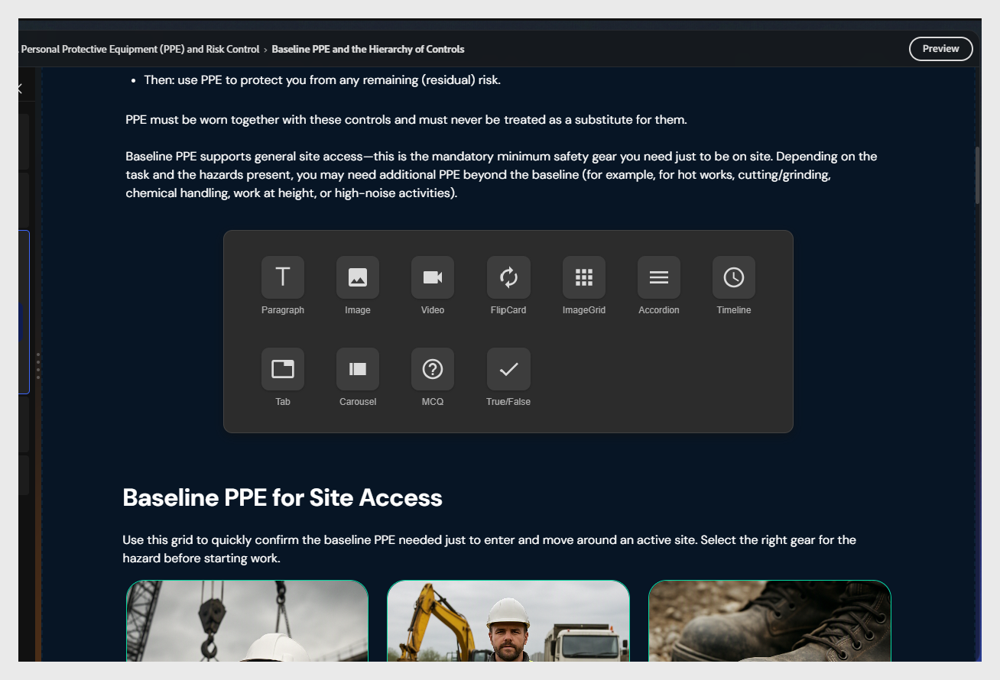
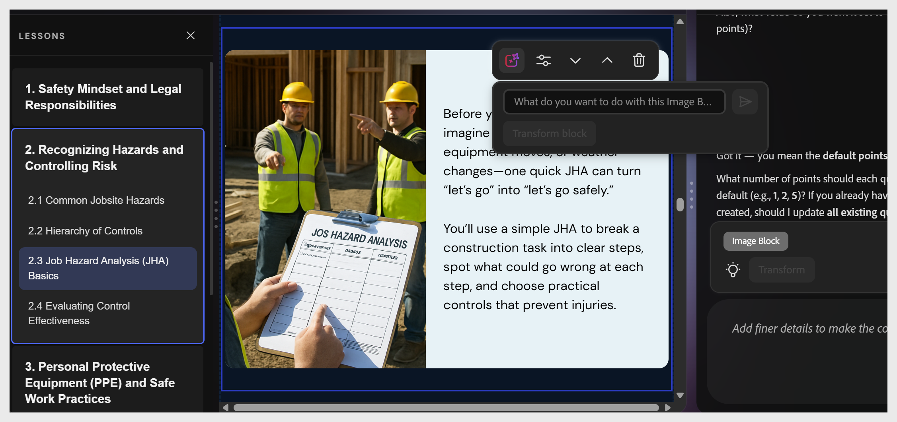

# コンテンツコンポーネントの追加

既存の2つのエレメントの間で選択します。 「+」ボタンが表示されます。 選択して、コンポーネントピッカーを開きます。

使用可能なコンポーネント：

<table>
  <thead>
    <tr>
      <th>コンポーネント</th>
      <th>用途</th>
    </tr>
  </thead>
  <tbody>
    <tr>
      <td><strong>段落</strong></td>
      <td>本文と説明</td>
    </tr>
    <tr>
      <td><strong>画像</strong></td>
      <td>イラスト、スクリーンショット、図</td>
    </tr>
    <tr>
      <td><strong>ビデオ</strong></td>
      <td>埋め込みMP4またはリンクビデオ</td>
    </tr>
    <tr>
      <td><strong>フリップカード</strong></td>
      <td>用語または定義のペア、インタラクションの表示</td>
    </tr>
    <tr>
      <td><strong>画像グリッド</strong></td>
      <td>グリッドレイアウトの複数の画像</td>
    </tr>
    <tr>
      <td><strong>アコーディオン</strong></td>
      <td>拡張可能なセクション、手順</td>
    </tr>
    <tr>
      <td><strong>タイムライン</strong></td>
      <td>順次イベントまたはプロセス・ステップ</td>
    </tr>
    <tr>
      <td><strong>Webオブジェクト</strong></td>
      <td>外部webコンテンツ、webページ、インタラクティブツール、アンケート、webアプリケーションをトピックスライドに直接埋め込むことができます</td>
    </tr>
    <tr>
      <td><strong>Tab</strong></td>
      <td>並列コンテンツ：比較、地域バリアント</td>
    </tr>
    <tr>
      <td><strong>カルーセル</strong></td>
      <td>切り替え可能な一連の画像またはコンテンツカード</td>
    </tr>
    <tr>
      <td><strong>MCQ</strong></td>
      <td>インラインの未評価のナレッジチェック</td>
    </tr>
    <tr>
      <td><strong>真/偽</strong></td>
      <td>インライン未評価の正誤検査</td>
    </tr>
  </tbody>
</table>

>[!NOTE]
>
>学習者が自分のペースをコントロールしてメリットを得られるようにする手順を順を追って説明するには、**アコーディオン**&#x200B;を使用します。 用語または定義のコンテンツには、**フリップカード**&#x200B;を使用してください。

## コンテンツコンポーザーコースへのWebオブジェクトの追加

Webオブジェクトでは、コース内のインラインフレームに外部コンテンツが表示されます。 学習者は、コースを離れることなくコンテンツを操作できます。 インタラクティブツール、埋め込みフォーム、アンケート、またはiframeの埋め込みをサポートするwebベースリソースに使用します。

### Webオブジェクトの追加

1. コンテンツコンポーザーでコースを開き、Webオブジェクトを追加するトピックに移動します。
2. トピックスライドの2つの既存の要素の間で選択します。 「**+**」ボタンが表示されます。
3. **+**&#x200B;を選択して、コンポーネントピッカーを開きます。
4. **Webオブジェクト**&#x200B;を選択します。 ブロックがキャンバスに表示されます。

### Webオブジェクトの設定

Webオブジェクトブロックツールバーの&#x200B;**設定**&#x200B;アイコンを選択して、構成パネルを開きます。

### コンテンツソースの設定

**コンテンツ**&#x200B;で、外部コンテンツの読み込み方法を選択します。

- **URL** – 埋め込むページまたはツールのWebアドレスを入力します。 コンテンツがインラインフレームのコースに読み込まれます。
- **埋め込みコード** – サードパーティのサービスから埋め込みスニペットを貼り付けます。 インタラクティブフォーム、アンケート、メディアプレーヤーなど、独自の埋め込みコードを提供するツールに使用します。
- **システム** – 接続されたシステムまたは統合からコンテンツを選択します。

### Heightを設定する

**フレームのHeight**&#x200B;フィールドで、埋め込まれたコンテンツのフレームのHeightをピクセル単位で設定します。 **+**&#x200B;コントロールと&#x200B;**−**&#x200B;コントロールを使用して値を調整します。 デフォルトは498 pxです。

埋め込まれたコンテンツの自然なHeightに合わせてフレームHeightを調整します。 小さすぎる値を設定すると、フレームの内側にスクロールバーが表示されます。大きすぎる値を設定すると、コンテンツの下に空白が表示されます。

### ロードおよび表示オプションの設定

- **自動ロード** – 選択すると、学習者がスライドに到達したときにWebコンテンツが自動的にロードされます。 コースの進行が遅くなるのを防ぐために、コンテンツの量が多いページではこのオプションをオフにします。 自動読み込みがオフの場合、学習者は読み込みをトリガーするフレームを選択します。
- **ブロックのタイトル** – オンに切り替えると、Webオブジェクトブロックの上に見出しが表示されます。 これを使用して、学習者が埋め込まれたコンテンツを操作する前に、そのコンテンツに関するコンテキストを提供します。

## トピック内でのコンテンツブロックの移動

ツールバーの編集オプションまたはAIを使用して、トピック内のコンテンツブロックの順序を変更できます。

