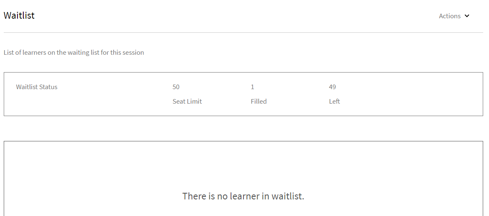
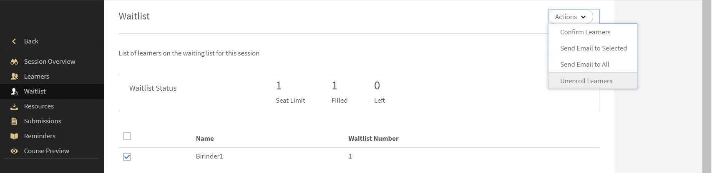
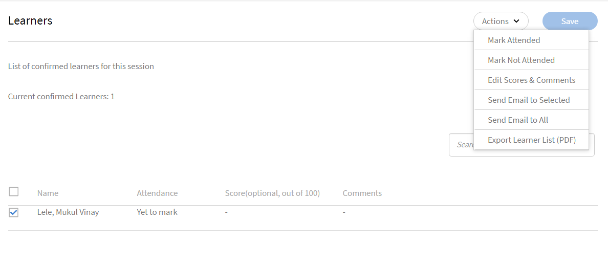
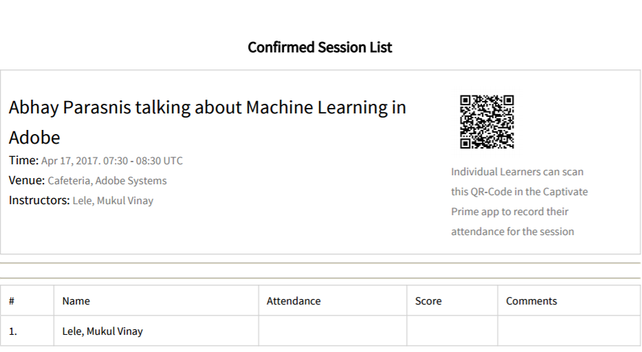
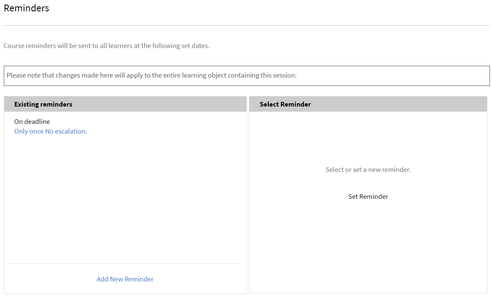
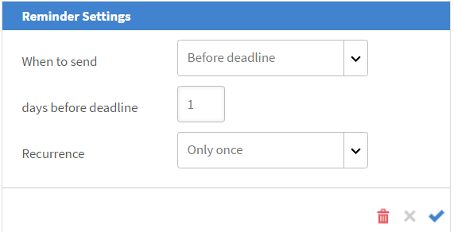
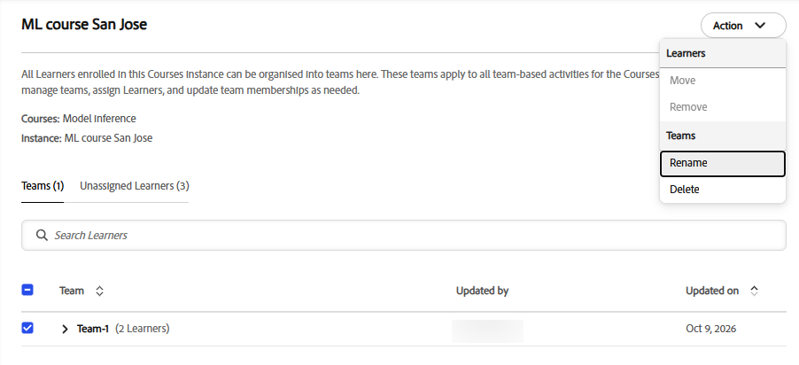
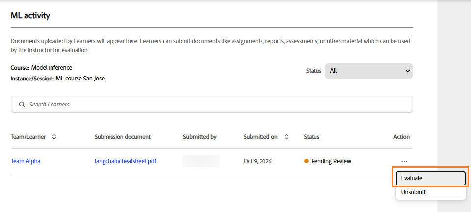
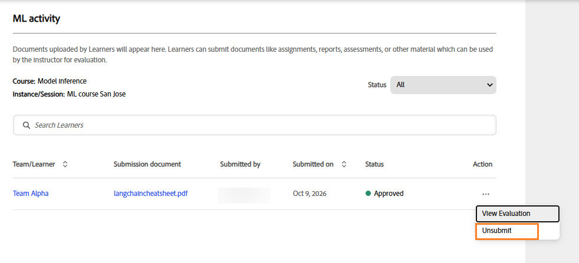

# セッションの学習者の管理

この記事では、出席者の管理、コース関連の電子メール送信、およびセッションのリマインダー送信を行う方法について学習します。

## レビューが保留中のセッションまたはモジュールの表示 {#pending}

インストラクタはレビューが保留中のセッションやモジュールを表示できます。

「セッション/モジュール」ページに列が表示されます **レビュー保留中** 対応するセッション/アクティビティの保留中のレビューの数が表示されます。

## セッションのキャンセル待ちの管理 {#managewaitlistforyoursession}

学習者がモジュールに登録すると、登録およびキャンセル待ちの最新ステータスを「キャンセル待ち」ページから確認できます。

1. インストラクタアプリの左側にあるナビゲーションペインで、予定されているセッション／キャンセル待ちを選択します。

   人数制限、現在埋まっている席数数、空席数を確認できます。 テーブルにはキャンセル待ちの学習者も一覧表示されます。 キャンセル待ちの学習者がいない場合は空白になります。

   
   *キャンセル待ちの学習者を表示*

1. キャンセル待ちテーブルで、確認対象の学習者を 1 人以上選択します。
1. アクション／学習者を確認を選択します。

   確認した学習者が確認済み学習者リストに追加されます。

インストラクタは学習者をセッションから登録解除できます。 これにより、学習者は該当する学習からも登録解除されます。 「**[!UICONTROL キャンセル待ち]**」タブを選択します。 チェックボックスを使用して、登録解除するユーザーを選択します。 登録を解除するには、**[!UICONTROL アクション]**/**[!UICONTROL 学習者の登録解除]**&#x200B;を選択します。

*学習者の登録解除*

### キャンセル待ちレポート

Adobe Learning Managerの新しい&#x200B;**[!UICONTROL キャンセル待ちレポート]**&#x200B;を使用すると、インストラクターは、コースのすべてのインスタンスについて、キャンセル待ちの学習者リストをダウンロードできます。 インストラクターは、**[!UICONTROL セッションの概要]**&#x200B;ページの&#x200B;**[!UICONTROL キャンセル待ち]**&#x200B;セクションからこのレポートにアクセスできます。

キャンセル待ちレポートで使用できる列は次のとおりです。

* コース名
* インスタンス名
* インスタンス ID
* インスタンスのステータス
* ユーザー名
* 電子メール
* ユーザーの一意の ID
* 登録日 (UTC タイムゾーン)
* ステータス
* キャンセル待ち番号
* キャンセル待ちの制限
* 人数制限

「インストラクター」セクションからレポートをダウンロードするには：

1. **[!UICONTROL インストラクター]**&#x200B;としてログインします。
2. ホームページから任意のセッションを選択します。
3. **[!UICONTROL セッションの概要]**&#x200B;ページで&#x200B;**[!UICONTROL キャンセル待ち]**&#x200B;オプションを選択します。
4. **[!UICONTROL アクション]** / **[!UICONTROL レポートの書き出し]**&#x200B;を選択して、**[!UICONTROL キャンセル待ち]**&#x200B;レポートをダウンロードします。

## セッション出席の記録 {#markattendanceforyoursession}

セッションに出席している確認済み学習者の数、これらの学習者の名前、学習者の出席ステータス、その他の詳細を「学習者」ページで確認できます。

1. 左側にあるナビゲーションペインで、予定されているセッション／学習者をクリックします。
1. 出席者のリストから学習者を 1 人以上選択し、次のいずれかの操作を実行します。

   * 出席を記録するには、アクション／出席を記録をクリックします。 出席済みと記録した後、ステータスを変更することはできません。
   * 欠席を記録するには、アクション／欠席をクリックします。
   * 解約などの理由で学習者を削除する場合は、 「アクション/学習者を削除」をクリックします。

   学習者は出席ステータスが出席済みになるまでモジュールを完了することはできません。

   
   *学習者の出席をマーク*

### 学習者の登録と出席に関するQRコードのダウンロード

インストラクターは、割り当てられたセッションのQRコードをダウンロードできます。学習者はQRコードをスキャンして、コースインスタンスに登録し、出席または完了をマークすることができます。

これにより、インストラクターは、管理者のサポートを必要とせずに、セッションへの参加を個別に管理できます。

次の手順は、両方に適しています。

* 教室での実際のセッション
* オンライン教室セッション

物理的な教室セッションの場合、インストラクターは正しいQRコードを生成し、学習者がセッションに出席する教室にペースト（または他の場所にペースト）する必要があります。これにより、学習者はQRコードをスキャンし、QRコードに応じて登録と出席、またはその両方をマークできます。

オンライン教室セッションの場合、インストラクターは生成されたQRコードをメールやメッセージングシステムなどの手段で送信することができます。これにより、学習者はQRコードをスキャンして、QRコードに基づいて登録や出席、またはその両方をマークすることができます。

#### セッションのQRコードのダウンロード

1. **インストラクター**&#x200B;のロールでAdobe Learning Managerにログインします。
2. **インストラクターダッシュボード**&#x200B;に移動します。
3. 関連する&#x200B;**コースインスタンス**&#x200B;を開きます。
4. 「**セッション**」タブを選択します。
5. 自分に割り当てられたセッションを選択します。
6. **セッションQRコード**を選択してください。
   

次のQRコードをダウンロードできます。

* **登録QRコード** – 学習者がコースインスタンスに登録できるようにします
* **出席QRコード** – セッションの出席を記録します
* **登録+出席のQRコード** – 学習者を登録し、1回のスキャンで出席をマークします

QRコードはPDFとしてダウンロードされ、デジタルでの共有やセッション中の表示が可能です。

#### 学習者がQRコードをスキャンした場合

* 学習者はモバイルデバイスを使用してQRコードをスキャンします。
* Adobe Learning Managerは、学習者とセッションを検証します。
* QRコードタイプに基づいて、次の操作を行います。
  * 学習者がコースインスタンスに登録されている場合、または
  * セッションの出席と完了が記録されます

すべての更新は、学習者のレコード、トランスクリプトおよびレポートに自動的に反映されます。

#### メモ

* QRコードは、セッションに割り当てられたインストラクターのみが使用できます。
* コースとセッションに設定された登録、出席、完了ルールは引き続き適用されます。
* 既存の学習者の進捗状況とレポートワークフローに変更はありません。

#### ユースケース

* 大量のオンサイトセッション（専門家向けの製品トレーニングなど）を実行している組織では、インストラクターがセッション固有のQRコードを印刷して、1回のスキャンで出席を登録および記録できます。

* 小売、製造、ヘルスケアのトレーニングでは、学習者がフロアから直接、または事前登録なしでセッションに参加することが多いため、「登録+出席」のQRコードをドアに配置することができます。 これにより、学習者は電話を使用して登録と出席をセルフサービスで行うことができます。

* パートナーやお客様向けのトレーニングイベントにより、オンサイトトレーナーは、管理者に新しいQRコードを確認しなくても、部屋の変更、追加セッション、または追加出席者に簡単に対応できます。

### カレンダーの招待 {#calendarinvites}

* 学習者またはインストラクターが教室またはバーチャルクラスルームセッションに登録されると、Learning Managerからカレンダーの招待状（ICSファイル）が送信されます。
* 招待状には以下が含まれます。

  * セッションの日時
  * セッションの詳細
  * 予定表の説明の&#x200B;**直接セッション参加リンク**

  

参加者はカレンダーイベントを開き、カレンダーから直接セッションに参加できます。

#### Gmailからセッションに参加する

1. **Googleカレンダー**&#x200B;を開きます。
2. セッションイベントを選択します。
3. イベントの詳細で、**セッション参加リンク**&#x200B;をクリックします。
4. Adobe Learning Managerまたは設定されたバーチャルクラスルームツールで直接セッションが開きます。

セッションリンクにアクセスするために元の電子メールを開く必要はありません。

#### 他のカレンダークライアントからのセッションへの参加

セッションリンクはカレンダーイベント本文に含まれており、以下からアクセスすることができます。

* Microsoft Outlook
* Appleカレンダー
* ICSファイルをサポートするその他のカレンダーアプリケーション

#### メモ

* カレンダーの招待状は、Learning Managerによって自動的に生成されます。
* カレンダー招待状のタイムゾーン情報は、学習者が選択したタイムゾーンに基づいて調整されます。
* この機能強化は、新しく生成されたカレンダーの招待状に適用されます。
* 管理者やインストラクターが追加の設定を行う必要はありません。

## 学習者の成功のマーク

インストラクターは、学習者ページから各学習者の成功ステータスを「合格」または「不合格」と直接マークできます。 この機能により、インストラクターは学習者のパフォーマンスに基づいて、教室またはバーチャルクラスルームセッションの結果を正確に記録できます。

学習者の合格をマークする手順は、次のとおりです。

1. インストラクターとしてAdobe Learning Managerにログインします。
2. 左側のナビゲーションウィンドウで&#x200B;**[!UICONTROL 今後のセッション]**&#x200B;を選択します。
3. **[!UICONTROL 学習者]**&#x200B;を選択します。
4. 学習者を選択して、**[!UICONTROL アクション]**&#x200B;を選択します。
5. 次のいずれかのオプションを選択して、選択した学習者の成功をマークします。

   * **[!UICONTROL 出席および合格のマーク]**:パスとマークされた学習者が、モジュールを正常に完了しました。
   * **[!UICONTROL 出席および不合格としてマーク]**:エラーとしてマークされた学習者は、モジュールを完了しましたが、合格しませんでした。

   
   _学習者の結果を記録するために、「出席と合格をマーク」オプションと「出席と不合格をマーク」オプションが強調表示されたアクションメニューが表示されている学習者ページ_

6. 確認プロンプトで「**[!UICONTROL はい]**」を選択します。

## 学習者への電子メールの送信 {#sendemailstolearners}

セッションの特定の出席者またはすべての出席者に電子メールを送信できます。 「電子メールを送信」機能は、学習者の出席を確認する場合、またはセッションに関するメッセージを送信する場合に非常に便利です。 割り当てまたはセッション資料を送信する場合、またはすべての学習者に一般的なメッセージを送信する場合は、「全員に電子メールを送信」オプションも使用できます。

学習者に電子メールを送信するには、インストラクタアプリの「学習者」ページで次のどちらかの操作を実行します。

* 特定の出席者に電子メールを送信するには、出席者を選択し、アクション／選択したユーザーに電子メールを送信をクリックします。
* すべての出席者にコース資料や割り当てを送信するには、アクション／全員に電子メールを送信をクリックします。

## 招待状の返信をキャプチャ

インストラクターは、ACAP管理者によって&#x200B;**[!UICONTROL 「返信を招待」]**&#x200B;オプションが有効になっている場合にのみ、学習者の招待回答をキャプチャできます。 この機能を有効にするには、管理者はサポートチーム([learningmanagersupport@adobe.com](mailto:learningmanagersupport@adobe.com))に問い合わせる必要があります。

完了すると、「**[!UICONTROL 学習者]**」セクションに招待状の回答が表示されます。 任意のセッションに移動し、**[!UICONTROL 学習者]**&#x200B;を選択して、ドロップダウンメニューから招待の回答を選択します。

## 学習者リストの書き出し {#exportinglearnerslist}

インストラクタは、出席者リストを PDF として書き出すことにより、すべての学習者の出席を簡単に記録できます。 出席者リストを書き出すには、左ペインにある「学習者」で、 アクション／学習者リスト (PDF) を書き出しをクリックします。

セッションの出席者リストを確認した後、リストを PDF として書き出すことができます。 この印刷しやすい PDF は学習者を表形式で示します。 これ以降、この PDF を使用して出席の記録、スコアの提供、学習者向けメモの作成または提供を実行できます。

この PDF の右上隅には QR コードが表示されます。 この機能を使用すると、個々の学習者は Learning Manager モバイルアプリでコードをスキャンすることにより、出席を記録できます。

*QRコードをスキャンして注意をマークする*

## 送信の承認または拒否 {#approveorrejectsubmissions}

セッションの割り当て、レポート、評価などの文書を学習者がアップロードした場合、これらの文書を「送信内容」ページで表示できます。 これらの文書は学習者を評価する際や、送信内容を承認または拒否する際に使用できます。

1. 左ペインで、セッションのスケジュールに基づいて「予定されているセッション」または「予定が過ぎたセッション」をクリックします。
1. 送信内容を表示するコースをクリックします。

   左ペインで、「送信内容」をクリックします。

1. 選択したセッションの学習者の送信内容を確認できます。 承認または拒否する送信内容を選択し、「承認」または「拒否」をクリックします。

   アクションに応じて送信内容のステータスが「承認」または「拒否」に変わります。

## セッションのリマインダーの設定 {#configureremindersforyoursession}

1. 左ペインで、「予定されているセッション」をクリックします。
1. リマインダーを設定するコースをクリックします。 左ペインで、「リマインダー」をクリックします。
1. 「リマインダーを選択」タイルで、「リマインダーを設定」をクリックします。

   
   *セッションのリマインダーを構成する*

1. 次の操作を行います。

   * リマインダーを設定ダイアログボックスで、学習者にリマインダーを送信するオプション（期日前、期日、期日後）を設定します。
   * 「期日前日数」フィールドで、リマインダーを期日の何日前に学習者に送信するかを設定します。
   * リマインダーの繰り返しを設定します。

   
   *リマインダー設定の表示*

1. 次のどちらかの操作を実行します。

   * チェックマークをクリックしてリマインダーを保存します。
   * ×マークをクリックしてリマインダーをキャンセルします。

   すべての学習者に対して、リマインダー設定で指定した日付にコースのリマインダーが自動送信されます。

   セッションのリマインダーを既に設定している場合は、「既存のリマインダー」タイルでリマインダーを確認できます。 また、既存のリマインダーにリマインダーを追加できます。

   既存のリマインダーを削除するには、リマインダーをクリックします。 表示されるポップアップで、削除アイコン（ごみ箱アイコン）をクリックしてリマインダーを削除します。

## Adobe Learning Managerでのグループの作成と管理

コースインスタンスの学習者からチームを手動で作成し、チームがロックされるまで、チームの追加、移動、削除、名前変更、または削除を行います。

インストラクターは、チームベースの提出モジュールを持つコースのインスタンスごとに、チームを作成します。 インスタンスに割り当てられたインストラクターは誰でもチームを管理できます。 Adobe Learning Managerでは、グループを自動的に作成することもできます。 チームを形成した後、学習者は作業を提出でき、チームの提出を評価できます。

### グループの管理ページを開く

1. インストラクターアプリの左側のナビゲーションペインで「**チーム**」を選択します。 このページには、学習者が割り当てられているチームベースのコースインスタンスが一覧表示されます。

   ![左側のナビゲーションウィンドウの[チーム]オプション](assets/Group-Team-submission-and-rubric-based-assessments-image17.png "チームの管理ページ")

1. コースを検索するには、コースを検索するか、最終更新日でリストを並べ替えます。

1. コースインスタンスを選択します。 インスタンスページには、割り当てられていない学習者とチームが表示されます。

### ルールを使用したチームの作成

1. インスタンスページで、割り当てられていない学習者を選択してチームに分けます。

1. ルールを選択します。 **アクション**/**単一チームを形成**&#x200B;または&#x200B;**複数チームを形成**&#x200B;を選択します。

   

1. **複数チームの作成**&#x200B;を選択した場合は、各チームの学習者数を入力します。 値は1以上である必要があります。 このページには、作成されるチームの数が表示されます。 例えば、学習者が94人、学習者が2人の場合、47のチームが作成されます。 登録済み学習者の数より多い場合は、エラーメッセージが表示されます。 小さい数値を入力してください。

   

   登録済み学習者の数より大きい値を入力すると、エラーメッセージが表示されます。

   

1. **チームの作成**&#x200B;を選択します。 チームは[**チーム**]タブに表示されます。

   ![作成されたチームを表示する[チーム]タブ](assets/Group-Team-submission-and-rubric-based-assessments-image21.png "作成されたチーム")

1. 確認して保存します。 チームは[**チーム**]タブに表示されます。

ルールは、選択した割り当てられていない学習者にのみ適用されます。 全員を再グループ化するには、まず既存のチームを削除します。 学習者が未割り当てのリストに戻ります。

**削除**&#x200B;を選択すると、次の確認ダイアログが表示されます。

**チームの削除**&#x200B;を選択します。 すべての学習者が、割り当てられていないリストに戻ります。

### 1つのグループを作成

1. チームに含める未割り当ての学習者を選択します。

1. **アクション**/**単一チームを形成**&#x200B;を選択します。 指定された数の学習者を使用して、チームが作成されます。

   

1. チームを保存します。 チームには少なくとも1人の学習者が必要です。学習者はインスタンス内の1つのチームにのみ属することができます。

1. この手順を繰り返して、チームを1つずつ作成します。

### 既存のチームへの学習者の追加

1. 追加する未割り当ての学習者を選択します。

1. を選択して既存のチームに割り当ててから、チームを選択します。

   

1. 選択を確定します。 **「学習者を割り当て」**&#x200B;を選択します。

### 学習者の移動または削除

1. 「**チーム**」タブを開き、チームを展開してメンバーを表示します。

1. 移動する学習者を選択します。

   

1. を選択して移動し、移動先のチームを選択します。

1. チームから学習者を削除するには、学習者を選択して削除します。 学習者が未割り当てのリストに戻ります。

チームに学習者が残っていない場合、チームは自動的に削除されます。

### グループ名の変更

1. 「**チーム**」タブで、チームを選択し、チーム名の変更を選択します。

1. **アクション** > **名前の変更**&#x200B;を選択します。

   

1. 「グループAlpha」などの一意の名前を入力します。

   

1. **チーム名の変更**&#x200B;を選択します。

名前は繰り返すことができず、Team-1などのシステム生成フォーマットは使用できません。

### チームを削除

1. 「**チーム**」タブで、1つ以上のチームを選択します。

1. **アクション** > **削除**&#x200B;を選択します。

1. **グループを削除**&#x200B;を選択します。

   

1. 確定します。 削除されたチームの学習者が、割り当てられていないリストに戻ります。

### 遅延登録と登録解除の処理

* チームが形成された後に登録する学習者は、「割り当てなし」リストに表示されます。 学習者をグループに追加します。
* すべてのチームがロックされている場合は、学習者のために新しいチームを作成します。
* 登録を解除した学習者は、チームから自動的に削除されます。 チームが続行され、空のチームが削除されます。

### トラブルシューティング

**チームを選択したり、そのメンバーを移動したりすることはできません。** チームは最初の送信後にロックされ、ロックはインスタンス内のすべてのチームモジュールに適用されます。 チームのロックを解除するには、提出を送信してください。 **チームの提出物を評価して送信を取り消す**&#x200B;を表示します。

**グループの名前を変更することはできません。** この名前は既に使用されているか、システムによって生成された形式と一致します。 別の名前を入力してください。

**グループを作成するときにエラーが表示されます。** 1つのグループに含めることができるメンバーは100人を超えることはできません。 チームあたりのメンバー数を減らします。

**インスタンスのTeams管理を開くことはできません。** チームの自動作成が実行されている可能性があります。 処理が完了すると、Accessが戻ります。

**保存は拒否され、ページが再読み込みされます。** 他のインストラクターまたは自動ジョブが変更を最初に保存しました。 更新されたチームを確認してから、変更をやり直してください。

**チームが姿を消しました。** 学習者がいないチームは自動的に削除されます。

## チームの提出物を評価して提出を取り消す

チームが再送信できるように、チームが送信したファイルの確認、評価計画の完了、作業の承認または却下、またはチームの送信の取り消しを行います。

チームの提出を評価すると、その結果はチームのすべてのメンバーに適用され、各メンバーが通知を受け取ります。 インスタンスに割り当てられたインストラクターのみが評価できます。 個々の提出の手順は同じですが、個々の提出にはチームの詳細がありません。 チームが最初に存在することを確認してください。 **チームの作成と管理**&#x200B;を表示します。

自動的に形成されたチームは、手動チームと同じように編集できます。

### 提出物を検索

1. インストラクターアプリで提出領域を開き、**チームの提出**&#x200B;を選択します。 学習者が1人のモジュールの場合は、**個々の提出**&#x200B;を選択します。

1. モジュールを検索するには、セッション名またはモジュール名で検索します。

1. モジュール名を選択します。

   

1. リストを絞り込むには、ステータスでフィルターします： **送信待ち**、**レビュー待ち**、**承認済み**、**拒否**、または&#x200B;**完了**。

1. チームメンバーを表示するには、チームを展開します。 名前と電子メールアドレスが表示され、ファイルを送信した学習者には&#x200B;**提出者**&#x200B;タグが含まれています。

1. 送信されたファイルをダウンロードするには、チームのダウンロードオプションを選択します。

### 提出物の評価

1. **レビューの保留中**&#x200B;ステータスのチームを見つけます。

1. 送信されたファイルを開き、コンテンツを確認します。

1. **アクション** > **評価**&#x200B;を選択します。

   

1. 評価計画を完了します。

   * すべての必要な質問に答えなさい。
   * 客観的な質問については、オプションを選択してください。 基準ベースのスコアリングでは、選択に応じてスコアが更新されます。
   * 主観的な質問については、回答を入力してください。
   * コメントが許可されている場合は、質問または評価全体にコメントを追加します。

   

1. モジュールにレビュー担当者の承認が必要な場合は、**[承認]**&#x200B;または&#x200B;**[拒否]**&#x200B;を選択します。 却下したらコメントを追加して、チームが修正候補を判断できるようにします。

   

1. モジュールで手動スコアリングを使用している場合は、全体スコアを入力します。

   

   **オプション**: **スコアにプライベートノートを追加**&#x200B;の切り替えを選択して、プライベートノートを入力します。 プライベートノートは、インスタンスに割り当てられたインストラクターにのみ表示されます。 「**コメントを表示**」を選択しても、学習者は表示できません。

1. 評価を送信します。 「**送信**」を選択します。 送信ステータスが&#x200B;**承認済み**&#x200B;に変わります。

   

承認されていない場合は、他のインストラクターも同じ提出物を評価できます。 提出物が承認されるまで、後の評価が前の評価に置き換わります。

モジュールにレビュー担当者の承認が不要な場合、チームの送信時にすべてのチームメンバーのモジュールが完了します。 送信オプションのみが表示され、後でスコアや注釈を編集することはできません。

チームの提出を承認または却下すると、学習者は提出ステータスと評価結果を確認できます。

評価結果を選択すると、評価パラメーターとインストラクターからのコメントが表示されます。

## 評価をレビューまたは変更する

1. **却下**&#x200B;ステータスのチームを検索します。

1. 完了した評価を開くには、**評価の表示**&#x200B;を選択します。

1. 再評価するには、「再評価」オプションを選択して、変更を送信します。 これは、却下された提出物に対してのみ実行できます。 **承認された提出物は変更できません**。

### 提出物の送信を取り消す

チームが再送信する必要がある場合、評価を最初からやり直す必要がある場合、またはロックされたチームを変更する必要がある場合は、送信を取り消します。 個別の提出の場合は、これを使用して、間違った学習者に対して入力された評価を修正することもできます。

1. 提出物があるチームまたは学習者を検索します。

1. 「**送信解除**」を選択します。

   

1. コメントを入力し、**送信取り消し**&#x200B;を選択してください。

   

送信が削除され、状態は&#x200B;**送信待ち**&#x200B;に戻ります。 チームのロックが解除され、メンバーを編集できるようになります。 チームメンバーは、通知と電子メールを受け取ります。 その後、任意のメンバーが再度送信でき、新しいファイルが以前のファイルを置き換えます。 新しい評価版は以前の評価版に取って代わり、履歴は残りません。

チームメンバーのコースを完了した後に送信を取り消すことはできません。これは完了を取り消すことができないためです。