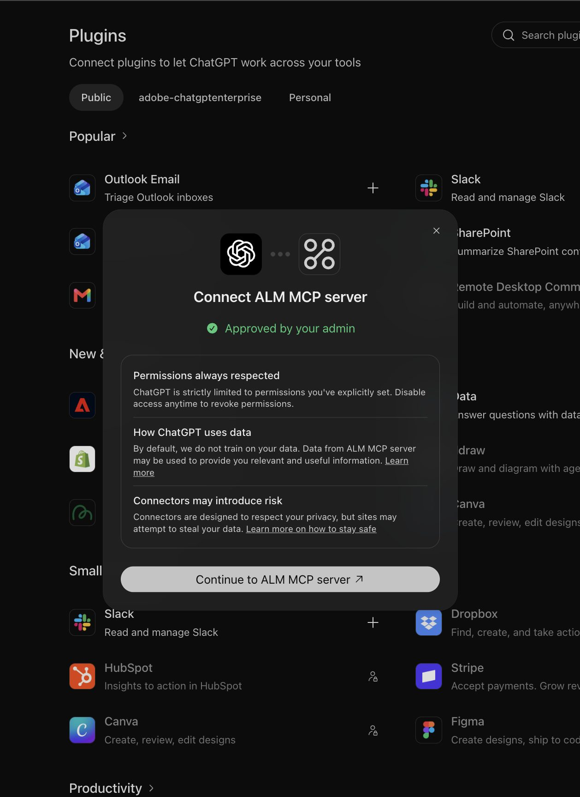

# Adobe Learning Manager MCPサーバーの設定

## 概要

設定には2つの手順があります。 まず、Adobe Learning ManagerでMCPサーバーを作成します。 次に、サーバーをAIアシスタントに接続します。 その後、学習者はAIアシスタントからAdobe Learning Managerで認証を受け、MCPツールを使用できるようになります。

## 要件

* MCPサーバーがLearning Managerアカウントで有効になっています。 有効にするには、AdobeカスタマーサクセスマネージャーまたはAdobeサポートにお問い合わせください。 それまでは、すべてのリクエストが403 Forbiddenを返します。
* MCPサーバーは、**Ultimate tier**&#x200B;アカウントでのみ使用できるバックエンドフラグ機能です。
* AIアシスタントの管理者には、そのプラットフォームでコネクターを追加および設定する権限があります。

## 動作の仕組み

ClaudeやChatGPTなどのMCPクライアントは、学習者のOAuthアクセストークンとともにMCPサーバーのURLにリクエストを送信します。 各ツールは、トークンが表す学習者の権限で実行されます。 そのため、学習者がMCPサーバーを使用して実行できるのは、Adobe Learning Managerで既に許可されている操作のみです。

サーバーはOAuth 2.0認可コードフローを使用します。 AIアシスタントは、Adobe Learning ManagerアプリケーションのクライアントIDとクライアントシークレットを使用して、機密クライアントとして認証します。 サーバーはOAuth動的クライアント登録をサポートしていません。

## Learning ManagerでのMCPサーバーの作成

MCPサーバーを作成すると、OAuthアプリケーションが設定され、MCPサーバーのURL、クライアントIDおよびクライアントシークレットが表示されます。

1. 統合管理者としてLearning Managerにサインインします。
2. ナビゲーションメニューで、**MCPサーバー**&#x200B;を選択します。
3. 右上隅の「**作成**」を選択します。

   

4. **アプリケーションの詳細**&#x200B;ページで、次の項目を入力し、**次へ**&#x200B;を選択します。

   * **アプリケーション名：**&#x200B;最大50文字を入力してください。たとえば、クロードの場合はALMと入力します。 学習者は接続を承認するとこの名前を表示するため、認識できる名前を選択してください。
   * **リダイレクトドメイン：**&#x200B;各AIアシスタントのコールバックドメインを入力します。1行につき1つのドメインを入力します。 それぞれをパスで始めます。パスは含めません。 このフィールドは必須です。
   * **説明：**&#x200B;たとえば、学習者がクロードのALMを使用できるように、150文字まで入力してください。

5. **ツールの構成**&#x200B;ページで、各ツールをいつ呼び出すかを決定するためにAIアシスタントが使用するツールと説明を確認します。 説明を変更するには、**アクション** (**...**) > **編集**&#x200B;を選択します。 既定の状態に戻すには、**リセット**&#x200B;を選択します。 次に、「**次へ**」を選択します。
6. **クライアント資格情報**&#x200B;ページで、**MCPサーバーURL**、**クライアントID**、および&#x200B;**クライアントシークレット**&#x200B;をコピーします。 安全に保管してください。 AIアシスタントを接続するために必要です。

MCPサーバーには常に学習者スコープが含まれているため、選択するスコープはありません。

接続するAIアシスタントごとにドメインを登録します。

| **AIアシスタント** | **登録するドメインをリダイレクトする** | **完全なコールバックURL （参照）** |
|----|----|----|
| クロード | [https://claude.ai](https://claude.ai/)および[https://claude.com](https://claude.com/) | <https://claude.ai/api/mcp/auth_callback> |
| ChatGPT | [https://chatgpt.com](https://chatgpt.com/) | <https://chatgpt.com/connector/oauth/&lt;id>\> （ChatGPTはセットアップ中にIDを表示します） |

>[!IMPORTANT]
>
>[https://chatgpt.com](https://chatgpt.com/)など、正確なドメインを登録します。 [https://*chatgpt.com*](https://chatgpt.com)*のようなワイルドカードは、関係のないドメインと一致する可能性があるため、使用しないでください。 サブドメインを許可するには、* [*https://*.example.com](https://encoded-592c9deb-987b-4562-aa3c-9fa3d37d83e9.uri/https%3a%2f%2f.example.com)のようなラベル全体のワイルドカードを使用してください。

リダイレクトドメインをすべて指定すれば、1台のMCPサーバーで複数のAIアシスタントを処理できます。 1つのアシスタントのアクセス権を他のアシスタントに影響を与えずに取り消すには、それぞれに個別のMCPサーバを作成します。 すべてのサーバが同じMCPサーバURLを使用します。

必要なのはMCPサーバーのURLだけです。 クラウドとChatGPTは、Learning ManagerのOAuthエンドポイントを自動的に検出します。 手動セットアップの場合は、Learning Manager MCPサーバーの[OAuthエンドポイント](#oauth-endpoints-reference)を表示します。

## MCPクライアントを接続する

AIアシスタントの管理者がMCPサーバーに接続します。 クライアントインターフェイスは頻繁に変更されます。 これらの手順が一致しなくなった場合は、クライアントのドキュメントを参照してください。

>[!NOTE]
>
>AIクライアントは、answer_learning_content_questionツールから返された応答をリフレームして形式化するため、解答の詳細はクライアントによって異なる可能性があります。

作業を開始する前に、MCPサーバーがアカウントで有効になっており、前のセクションのMCPサーバーURL、クライアントID、およびクライアントシークレットがあることを確認します。

### Connect Cloud ProまたはMax

**注意：** answer_learning_content_questionツールからの回答が再構成され、クライアントによってフォーマットされると、質問に対する回答の詳細によって変化が生じます。

1. クロードで、**カスタマイズ** \> **コネクター**&#x200B;に移動します。
2. **[追加]** (+)を選択し、**[カスタムコネクターの追加]**&#x200B;を選択します。
3. コネクターの詳細を入力し、**続行**&#x200B;を選択してください：

   1. **名前：**&#x200B;学習者が認識できる名前を入力してください（例： Adobe Learning Manager）。
   2. **リモートMCPサーバーのURL:**&#x200B;クライアント資格情報ページからMCPサーバーのURLを[https://\[alm-host\]/v1/mcp](https://[alm-host]/v1/mcp)の形式で入力してください。

4. **認証**&#x200B;で、**今すぐサインイン**&#x200B;を続けてください。 ClaudeはLearning ManagerのOAuth設定を読み取り、一致するオプションを&#x200B;*検出済み*&#x200B;としてマークします。
5. **OAuthクライアント**&#x200B;で、**独自のOAuthクライアントを使用**&#x200B;を選択します。 **クライアントID**&#x200B;と&#x200B;**クライアントシークレット**&#x200B;を貼り付けます。
6. 「**追加**」を選択します。 Learning Managerのログインページが開きます。 ログインすると、コネクターは接続済みとして表示されます。

>[!NOTE]
>
>クラウドでは「クライアントシークレット」フィールドにオプションのラベルが付けられますが、Learning Managerでは必須です。 空のままにするか、間違った値を入力すると、「認証に失敗しました」というメッセージが表示されてログインに失敗します。

### クラウドグループ版またはエンタープライズ版に接続

コネクターを追加できるのは、組織のオーナーまたはコネクターを管理できるロールを持つメンバーのみです。 クライアントIDまたはクライアントシークレットはメンバーに表示されません。

>[!NOTE]
>
>answer_learning_content_questionツールからの回答がクライアントによってリフレームされ、フォーマットされるにつれて、変更が提示された質問への回答の詳細が示されます。

1. Claudeで、組織の所有者またはコネクターを管理する権限を持つメンバーとしてログインします。
2. **組織の設定** \> **コネクター**&#x200B;に移動します。
3. **追加**&#x200B;を選択し、**カスタム**&#x200B;にカーソルを合わせ、**Web**&#x200B;を選択します。
4. 名前とMCPサーバーURLを入力し、前の手順の手順4および5で説明したように、**認証**&#x200B;と&#x200B;**OAuthクライアント**&#x200B;を設定します。
5. 「**追加**」を選択します。

これで、組織がコネクターを使用できるようになりました。 各メンバーが&#x200B;**Connect**&#x200B;を選択し、自分のアカウントでLearning Managerにサインインします。

### ChatGPTグループ版またはエンタープライズ版に接続

>[!NOTE]
>
>answer_learning_content_questionツールからの回答がクライアントによってリフレームされ、フォーマットされるにつれて、変更が提示された質問への回答の詳細が示されます。

1. ワークスペースの所有者または管理者としてChatGPTにログインします。
2. 左側のサイドバーで、「**プラグイン**」をクリックします。
3. 右上隅の「**追加**」をクリックし、「**MCPアプリを作成**」を選択します。
4. **新しいプラグイン**&#x200B;ウィンドウで、接続を構成します。

   * **名前：** Adobe Learning Manager、または学習者が知っている学習プラットフォームの名前。
   * **接続：** **サーバーURL**&#x200B;を選択したままにして、[https://\[alm-host\]/v1/mcp](https://[alm-host]/v1/mcp)を入力してください
   * **認証：** OAuth

   

5. **[OAuthの詳細設定]**&#x200B;をクリックします。 ChatGPTは、ALM OAuthエンドポイントを自動的に検出します。
6. **クライアント登録**&#x200B;で、**登録方法**&#x200B;を&#x200B;**ユーザー定義OAuthクライアント**&#x200B;に設定し、手順1で使用した&#x200B;**OAuthクライアントID**&#x200B;と&#x200B;**OAuthクライアントシークレット**&#x200B;を入力します。
7. このパネルに表示される&#x200B;**コールバックURL**&#x200B;を確認してください。 そのドメイン(<https://chatgpt.com>)は、手順1でMCPサーバーの&#x200B;**リダイレクトドメイン**&#x200B;に含まれている必要があります。

   

       **エンドポイントは自動的に検出されます**
   
   通常は、OAuthエンドポイントを変更する必要はありません。 ChatGPTから要求された場合は、次を使用します：認証URL [https://\[alm-host\]/oauth/o/authorize](https://[alm-host]/oauth/o/authorize)、トークンURL [https://\[alm-host\]/oauth/token](https://[alm-host]/oauth/token)、登録URLが空、リソース[https://\[alm-host\]/v1/mcp](https://[alm-host]/v1/mcp)、スコープlearner:write。

8. **理解したうえで続行する**&#x200B;を選択し、[**作成**]をクリックします。
9. **接続**&#x200B;ウィンドウで、**続行**&#x200B;をクリックし、ALMにサインインします。 ウィンドウに、*管理者によって承認*&#x200B;と表示されます。
10. ワークスペースのターゲットユーザーがプラグインを使用できるようにします。

    

## エンドユーザー認証

管理者が設定を完了すると、学習者はAIアシスタントのコネクターのリストからAdobe Learning Manager コネクターを追加し、「接続」を選択します。 Adobe Learning Managerログインページが開きます。 学習者が（アカウントで使用している場合はSSOを介して）ログインしてアクセスを承認すると、AIアシスタントが学習者のAdobe Learning Managerアカウントにリンクされます。

>[!NOTE]
>
>ブラウザーに既にアクティブなAdobe Learning Managerセッションがある場合、アシスタントは資格情報を要求せずにそのユーザーに接続します。 別のユーザーとして接続するには、まずAdobe Learning Managerからログアウトするか、プライベートブラウザーウィンドウを使用します。

認証は1回限りの手順です。 学習者のアクセス権が取り消された場合、または学習者のセッションが期限切れになった場合は、アシスタントによって再度ログインするように求められます。

## クライアントシークレットを回転するか、アクセスを取り消す

クライアントシークレットを再生成することはできません。 回転するには：

1. この記事で説明したように、新しいMCPサーバーを作成します。
2. 新しいクライアントIDとクライアントシークレットでAIアシスタントを更新します。
3. **統合管理者** > **MCPサーバー**&#x200B;で、古いサーバーの&#x200B;**アクション** (**...**) > **削除**&#x200B;を選択します。

切り替え後、学習者は再度ログインする必要があります。

すべての学習者のAIアシスタントの接続を解除するには、同じページからMCPサーバーを削除します。

## 使用可能なツール

MCPサーバは、次のツールを表示します。 これらはすべて、ログインした学習者の権限で実行されます。

<table>
<colgroup>
<col style="width: 46%" />
<col style="width: 31%" />
<col style="width: 21%" />
</colgroup>
<thead>
<tr>
<th><strong>ツール</strong></th>
<th><strong>機能</strong></th>
<th><strong>プロンプトの例</strong></th>
</tr>
</thead>
<tbody>
<tr>
<td>search_learning_items</td>
<td>コース、学習パス、資格認定、作業計画書、バッジ、スキル、カタログ、タグをカタログで検索します。 フィルター：タイプ、学習者の状態、スキル、タグ、カタログ、配信形式、価格、言語。 1ページあたり最大10件の結果を返します。</td>
<td>「初級Pythonコース」 
「フランス語の無料クラスルームトレーニング」</td>
</tr>
<tr>
<td>list_my_learning_enrollments</td>
<td>学習者の登録済み学習、進行中の学習、完了済み学習、状態、進捗状況、期日が一覧表示されます。 デフォルトでは、最後に登録されたユーザーが最初に登録されます。</td>
<td>「私は何に登録しているのですか？」 
「もうすぐ何が予定されているんだ？」 
「完了したトレーニング」</td>
</tr>
<tr>
<td>get_learning_object</td>
<td>IDによって、コース、学習パス、資格認定、作業計画書の詳細を取得します。インスタンス、スキル、サブ項目を含めることもできます。</td>
<td>「二つ目の授業の話をもっと聞かせてくれ」</td>
</tr>
<tr>
<td>get_my_learning_profile</td>
<td>アカウントおよびマネージャーを含む学習者のALMプロファイルを取得します。</td>
<td>「ALMの管理職はだれですか？」</td>
</tr>
<tr>
<td>answer_learning_content_question</td>
<td>引用符付きのコースコンテンツに基づくALM学習アシスタントを使用して、コースの主題に関する質問に回答します。 アシスタントがフォローアップの質問に使用する会話IDを返します。</td>
<td>「ネットワークのコースで説明したTCPとUDPの比較」</td>
</tr>
<tr>
<td>personalized_learning_path</td>
<td>学習者の目標、トピック、学習ニーズに合わせてカスタマイズされた学習パスをAdobe Learning Managerで提供します。 コース推奨の生成、選択した学習パスの学習者アカウントへの保存、学習者の保存済み学習パスのリスト（アクションリスト）、およびIDを使用した保存済み学習パスの詳細とコースの取得（アクションの詳細）をサポートします。 学習者が関連する学習コンテンツを特定し、スキルを磨き、学習目標を達成するのに役立ちます。</td>
<td>選択した学習パスをアカウントに保存します。</td>
</tr>
</tbody>
</table>

answer_learning_content_questionから開始した会話は、ALM学習アシスタントの会話と同様に、学習者AI会話レポートに表示されます。

## 制限

| **上限** | **値** |
|----|----|
| ページあたりの結果（検索と登録） | 最大10。 返されたカーソルを他のページに使用します。 |
| answer_learning_content_question rate | 学習者1人あたり1分あたり10件のリクエスト（バースト5件）。一度に最大2件の処理中 |
| サポートされるMCPプロトコルのバージョン | 2025-11-25, 2025-06-18, 2025-03-26 |
| 輸送 | ストリーム可能なHTTP、ステートレス（POSTのみ。サーバー送信イベントストリームなし） |

## OAuthエンドポイントリファレンス {#oauth-endpoints-reference}

クラウドとChatGPTは、これらを自動的に検出します。 これらは、手動で入力する必要があるクライアントまたはプロキシ用にここにリストされています。 `alm-host`をMCPサーバーURL内のホスト（地域のホストまたはALMカスタムドメイン）に置き換えます。

| **値** | **URL** |
|----|----|
| MCPサーバーのURL | [https://\[alm-host\]/v1/mcp](https://[alm-host]/v1/mcp) |
| 認証URL | [https://\[alm-host\]/oauth/o/authorize](https://[alm-host]/oauth/o/authorize) |
| トークン URL | [https://\[alm-host\]/oauth/token](https://[alm-host]/oauth/token) |
| URLを更新 | [https://\[alm-host\]/oauth/token/refresh](https://[alm-host]/oauth/token/refresh) |
| 認証サーバーベース | [https://\[alm-host\]](https://[alm-host]) |
| リソース | [https://\[alm-host\]/v1/mcp](https://[alm-host]/v1/mcp) |
| 範囲 | 学習者:write |

## トラブルシューティング

| **現象** | **原因と修正** |
|----|----|
| ログイン中の未登録リダイレクト | AIアシスタントのコールバックドメインが、アプリケーションの&#x200B;**リダイレクトドメイン**&#x200B;にありません。 追加して（例： <https://claude.ai>）、もう一度やり直してください。 |
| ログインに成功すると、アシスタントに「認証に失敗しました（無効なクライアント）」と表示される | アシスタントに入力されたクライアントシークレットがアプリケーションと一致しません。 ALMからもう一度コピーし、余分なスペースがないか確認して、再接続します。 |
| すべてのリクエストが403を返します。禁止 | MCPサーバーがアカウントで有効になっていません。 Adobeサポートに連絡してください。 |
| 間違ったALMユーザーとして接続されている | ブラウザーには既にALMセッションが存在します。 切断し、ALMからログアウト（またはプライベートウィンドウを使用）して、再度接続します。 |
| Q&amp;Aツールの「レート上限を超えました」 | 学習者がQ&amp;Aレート制限を超えました。 しばらく待ってから、もう一度やり直してください。 |
| アシスタントから再度ログインするように求められます | 学習者のトークンの有効期限が切れたか、取り消されました。 もう一度「**接続**」をクリックします。 |

## CSV に関する FAQ

**学習者は、管理者がMCPサーバーを設定せずにMCPサーバーを使用できますか？**
掲示板で 統合管理者は、Adobe Learning ManagerでMCPサーバーを作成する必要があります（手順1）。MCPサーバーは動的クライアント登録をサポートしていないためです。

**独自のドメインを使用できますか？**
はい。 Adobe Learning Managerアカウントにカスタムドメインがある場合は、すべてのURLで`alm-host`の代わりに使用します。

**MCPサーバーを使用できるALMの役割はどれですか？**
すべてのAdobe Learning Managerユーザーが接続可能 ツールは学習者のコンテキストで機能し、ALM独自の権限チェックがすべてのリクエストに適用されます。
